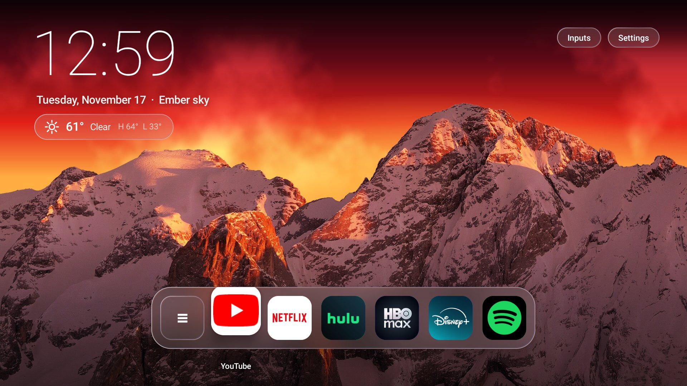
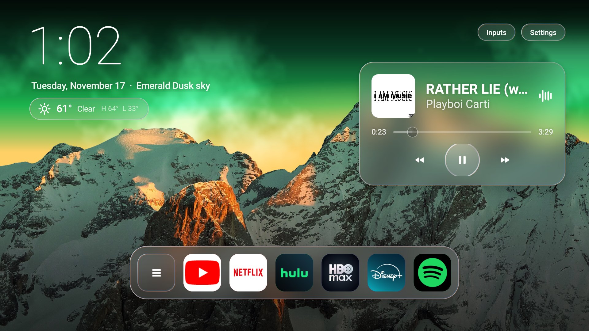
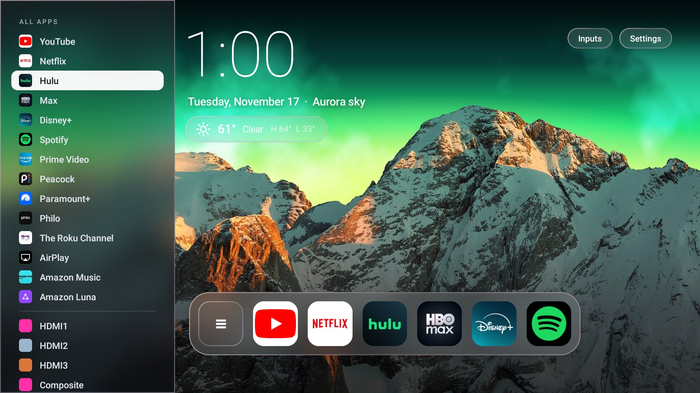
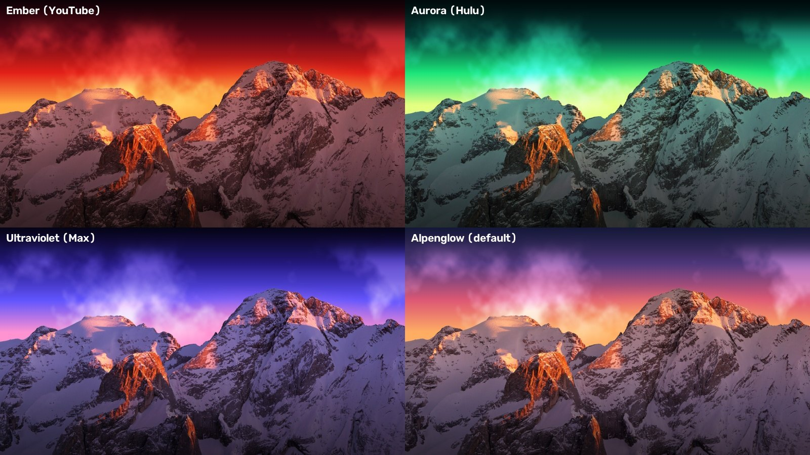

# Sunset Home

**A liquid-glass home screen for Amazon Fire TV where the sky changes color for every app.**

The Fire TV home screen is mostly ads. Sunset Home replaces it with a mountain sunset: a real photo of the Marmolada in the Dolomites with the sky cut out and repainted live. Land on YouTube and the sky turns ember red; land on Hulu and it turns into an aurora; land on Spotify and you get an emerald dusk, with the light on the snow shifting to match. Glass panels float over it, showing what's playing, the weather and your apps.



[](https://github.com/Nimay25/sunset-home/actions/workflows/build.yml)


**[Try the web preview →](https://nimay25.github.io/sunset-home/)** · **[See the 18 layouts it started from →](https://nimay25.github.io/sunset-home/gallery.html)**

## What it does

| | |
|---|---|
|  |  |
| **Now playing.** Whatever Spotify is playing on the TV: album art, title, artist, a live waveform, a progress bar and glass play/pause/skip buttons that work from the remote. | **Everything drawer.** Press ◀ on ≡ and a glass panel slides out with every app, every HDMI input and Settings, each with its own sky. |

- **17 hand-made skies:** YouTube *Ember*, Netflix *Crimson Night*, Prime Video *Glacier*, Hulu *Aurora*, Max *Ultraviolet*, Disney+ *Starlit Gold*, Peacock *Peacock Plume*, Paramount+ *Midnight Summit*, Philo *Lilac Haze*, The Roku Channel *Grape and Peach*, Spotify *Emerald Dusk*, AirPlay *Cotton Candy*, Amazon Music *Lagoon*, the HDMI inputs *Neon*, *Steel Dawn* and *Copper Dusk*, and *Alpenglow* for everything else. Apps it doesn't know get a generated sky.
- **Liquid glass** panels with a blurred, slightly magnified view of the sky behind them, a specular highlight, a bright rim and a faint red/blue edge fringe.
- **Weather** for Columbia, SC from [Open-Meteo](https://open-meteo.com) (free, no account), with line icons for clear, partly cloudy, cloudy, fog, drizzle, rain, snow and storms. It refreshes every 20 minutes.
- **The real Home button.** Press Home from any app and you land here in under half a second, not on Amazon's screen. It survives reboots.
- **HDMI inputs** open in the launcher's own full-screen view, so Back returns home.
- **Tiny and quiet:** about 670 KB, plain Java and Android views, no libraries, no analytics, about 74 MB of memory on the home screen.



## How the sky works

The background is six layers, drawn by `SkyView` every time the focus moves:

1. **Sky gradient:** four colors from the app's palette, top to horizon.
2. **Sun glow:** a wide ellipse of the horizon color just above the ridge.
3. **Clouds:** a generated grayscale texture blended with *overlay*, so mid-gray changes nothing, bright streaks lighten and gaps darken. The color comes entirely from the sky underneath.
4. **Cloud glow:** the brightest clouds lit with the app's highlight color (*screen* blend).
5. **Mountains:** the photo with its sky removed. The cutout came from a hand-traced ridgeline refined with OpenCV GrabCut (`design/seg_marm.py`).
6. **Alpenglow tint:** the mountain's own outline used as a mask for a gradient in the palette's rim color, blended with *overlay*, so the snow catches each sky's light.

The colors fade over about a second with an `ArgbEvaluator`.

### Liquid glass without a blur API

Fire OS 7 is Android 9, which has no view blur (`RenderEffect` arrived in Android 12). So `SkyView` also paints the same scene into a 240×135 bitmap, `Glass` box-blurs it three times, and every glass panel draws its own piece of that bitmap through a `BitmapShader`. The shader is scaled up 8× to the screen and magnified 6% around the panel's center, which reads as refraction. Then a white tint, a top highlight, a gradient rim and two offset hairlines (warm and cool) for the chromatic edge.

### Now playing without a Spotify login

Spotify's TV app publishes a standard Android media session. Sunset Home reads it through `MediaSessionManager`, which Android only allows for an enabled notification listener, so `NowPlaying` is an empty listener that reads no notifications. Spotify's servers aren't involved, so there's no login and no API key. The catch: the card only shows music that plays **on the TV** (open Spotify there, or pick the TV as the speaker from your phone).

### Taking the Home button

Fire OS has no "default launcher" setting, and Amazon's launcher is protected. The takeover is adapted from [dumbtv home](https://github.com/humblemuzzu/dumbtv) (MIT). A small accessibility service (`Guard`) watches only for window changes. When Amazon's home window appears, it covers it with black and starts Sunset Home through an alarm, because alarm launches skip Android's 5-second "app switch" delay once `min_futurity=0` is set.

## Install

You need a Mac or Linux machine on the same Wi-Fi as the TV, `adb`, JDK 17 and the Android SDK command-line tools (platform 28 plus build-tools).

```bash
brew install --cask android-platform-tools
brew install openjdk@17 android-commandlinetools
sdkmanager --sdk_root=/opt/homebrew/share/android-commandlinetools "platforms;android-28" "build-tools;34.0.0"
```

On the TV: **Settings → Device & Software → About**, press OK on the device name 7 times, then turn on **Developer Options → ADB debugging**.

```bash
adb connect <tv-ip>:5555        # press Allow on the TV
./build.sh                      # builds build/sunset-home.apk
ADB_SERIAL=<tv-ip>:5555 ./install.sh
```

`install.sh` installs the APK, grants media access for the player card, turns on the Home guard, sets `min_futurity=0` and opens Sunset Home.

**No build tools?** Download the APK from [Releases](https://github.com/Nimay25/sunset-home/releases), clone this repo, and run `ADB_SERIAL=<tv-ip>:5555 ./install.sh ~/Downloads/sunset-home-v2.0.apk`. Only `adb` is needed.

**Undo:** `ADB_SERIAL=<tv-ip>:5555 ./install.sh --undo` hands Home back to Amazon and switches off everything the installer switched on. The app stays installed until you run `adb uninstall tv.rajs.sunset`.

When you're done, switch ADB debugging back off on the TV.

### Make it yours

- **Dock apps:** `DOCK` in `Home.java`.
- **Skies:** `Skies.java` has one line per app: six colors (sky top, upper sky, middle, horizon, cloud glow, light on the peaks).
- **Weather location:** the latitude and longitude in `Weather.java`.
- **Your own photo:** trace the ridgeline in `design/seg_marm.py`, run it, then `design/gen_clouds.py`, and copy the outputs into `res/drawable-nodpi/`.

## Also: removing Amazon's ads and tracking

This repo doesn't touch Amazon's packages. The cleanup on the TV in the screenshots was done with [dumbtv](https://github.com/humblemuzzu/dumbtv) (cleanup only, no DNS filter). See [docs/CLEANUP.md](docs/CLEANUP.md) for exactly what was run and how to undo it.

## Project layout

```
src/tv/rajs/sunset/
  Home.java        the home screen: clock, weather, player, dock, drawer, remote navigation
  SkyView.java     the six-layer sky and the small backdrop for glass
  Glass.java       blur + glass panels
  Player.java      now playing from Android media sessions
  Weather.java     Open-Meteo current weather
  Icons.java       transport, waveform and weather icons drawn in code
  Skies.java       the palettes and app looks
  Guard.java       Home button takeover (from dumbtv, MIT)
  Input.java       full-screen HDMI input (from dumbtv, MIT)
design/            cutout, cloud and preview scripts, the source photo, the web demo template
docs/              the web preview and the layout gallery (GitHub Pages)
```

## Credits and licenses

- Code: MIT, see [LICENSE](LICENSE). `Guard`, `HomeRetry`, `OwnWindow`, `Input` and the Home takeover in `install.sh` are adapted from [dumbtv home](https://github.com/humblemuzzu/dumbtv) by humblemuzzu, MIT ([NOTICE-dumbtv-LICENSE](NOTICE-dumbtv-LICENSE)).
- Photo: [Marmolada Sunset](https://commons.wikimedia.org/wiki/File:Marmolada_Sunset.jpg) by Dmitry A. Mottl, [CC BY-SA 3.0](https://creativecommons.org/licenses/by-sa/3.0/). The cutout (`res/drawable-nodpi/sky_mountains.webp`) is a derivative and is shared under the same license.
- Weather: [Open-Meteo](https://open-meteo.com), CC BY 4.0.
- App names and icons belong to their owners. The launcher shows the icons installed on your TV and ships none.

Not affiliated with Amazon, Spotify or any app shown. Use at your own risk. Everything here is reversible, but it's your TV.

Built with [Claude Code](https://claude.com/claude-code).
